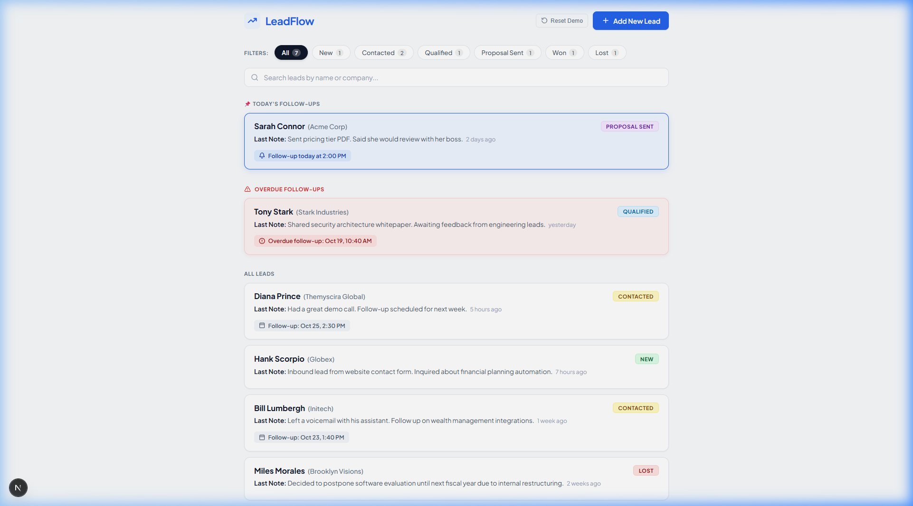
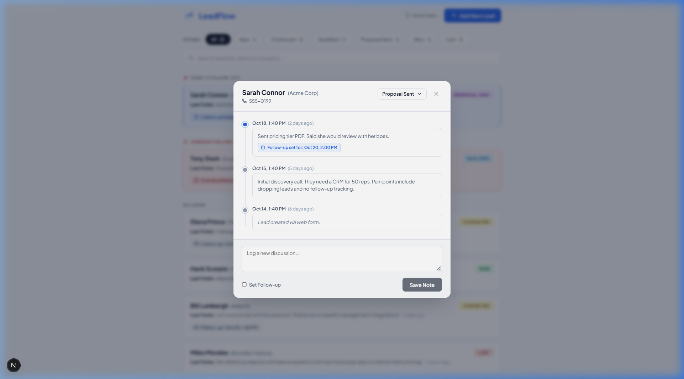
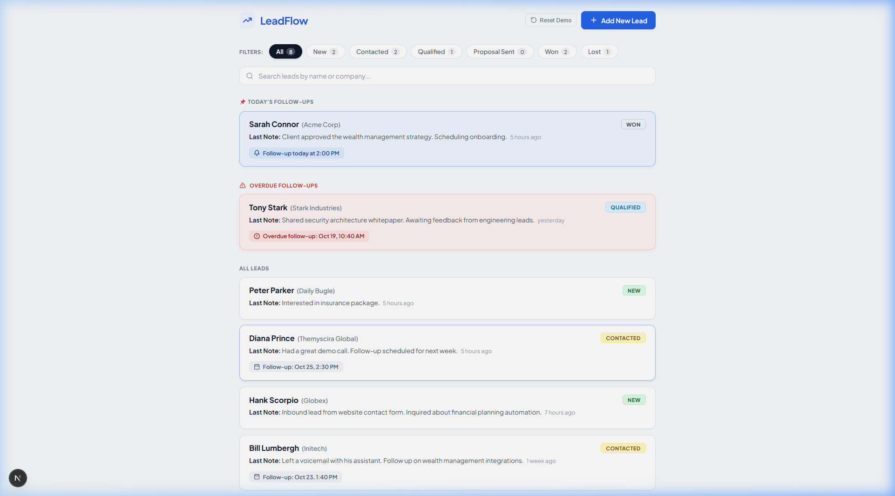

# LeadFlow 📈 — Lightweight Lead Management CRM

> **Built for the Pravar AI — AI-Smart Fullstack Intern Coding Assessment**  
> *Empowering financial advisors and sales teams to treat every customer as their top customer through timely advice, seamless discussion logging, and proactive follow-up tracking.*

---

## 🌟 Overview & Key Flows

LeadFlow is a high-performance, single-screen CRM designed for high-velocity wealth management advisors and sales representatives. It combines a responsive Next.js frontend with a typed Python FastAPI backend.

### Core Flows (As Requested)
1. **Single-Screen Lead List**
   - Displays all leads with: Name, Company, Status badge, Last discussion note snippet, and humanized relative time (e.g. *2 hours ago*, *2 days ago*).
   - **Today's follow-ups are pinned at the top** with an active reminder badge (`🔔 Follow-up today at 2:00 PM`).
   - Dynamic status filter pills (**All**, **New**, **Contacted**, **Qualified**, **Proposal Sent**, **Won**, **Lost**) with real-time count badges.
2. **Interactive Lead Timeline Dialog**
   - Clicking any lead opens an in-page modal dialog (no page reload).
   - Shows the full discussion history in **strict reverse-chronological order** with a connected visual timeline.
   - Real-time **status changer** dropdown with instant persistence to the backend and immediate reflection in the list.
   - Discussion logger at the bottom with note input + optional **Follow-up Date & Time picker**.
   - Scheduling a follow-up automatically updates the lead's reminder and pins it when scheduled for today.
3. **Add New Lead Modal**
   - Click `+ Add New Lead` to open modal.
   - Name is required; company, phone number, and initial note are optional.
   - Status defaults automatically to `New`.

---

## 🎁 Bonus Features Implemented

- ✅ **Search Leads by Name & Company**: Instant, debounced search box with clear button.
- ✅ **Overdue Follow-ups Highlighted in Red**: Follow-ups from the past are pinned with a red warning badge (`⚠️ Overdue follow-up`) and rose-tinted card styling.
- ✅ **Docker Compose Setup**: Production-ready `docker-compose.yml` with backend and frontend containers, volume persistence, and healthchecks.
- ✅ **Database Seed Script**: Pre-configured with realistic leads (`Sarah Connor`, `Hank Scorpio`, `Bill Lumbergh`, `Bruce Wayne`, `Tony Stark`, `Miles Morales`).
- ✅ **One-Click "Reset Demo" Button**: Reviewers can reset the database back to clean demo data at any time directly from the top navigation bar or via API.
- ✅ **Automated Test Suite**: 10 automated test cases in `backend/test_api.py` covering health check, CRUD operations, reverse-chronological sorting, validation errors (HTTP 422), and missing records (HTTP 404).

---

## 📸 Screenshots & Video Demo

| Main Dashboard (Pinned Today's & Overdue) | Lead Timeline & Discussion Dialog |
| :---: | :---: |
|  |  |

| Updated State & New Lead Added |
| :---: | :---: |
|  |

---

## 🛠️ Tech Stack

- **Frontend**: [Next.js](https://nextjs.org/) (App Router, TypeScript), custom CSS design system inspired by modern fintech tools, [Lucide React](https://lucide.dev/) icons.
- **Backend**: [FastAPI](https://fastapi.tiangolo.com/) (Python 3.11+ / 3.12 / 3.14), [SQLAlchemy 2.0](https://www.sqlalchemy.org/), [Pydantic v2](https://docs.pydantic.dev/), SQLite.
- **Containerization**: Docker & Docker Compose.

---

## 🚀 Quickstart & Setup Guide

### Option 1: Running Locally (Recommended)

#### Prerequisites
- **Python 3.10+**
- **Node.js 18+ & npm**

#### 1. Clone the repository
```bash
git clone <your-repo-url>
cd LeadFlow
```

#### 2. Configure Environment Variables
Copy the example environment configuration:
```bash
# On Windows PowerShell
cp .env.example .env

# On Linux/macOS
cp .env.example .env
```

#### 3. Setup and Start Backend (FastAPI)
```bash
# In project root:
cd backend

# Create and activate virtual environment
python -m venv venv

# Windows PowerShell:
.\venv\Scripts\activate
# Linux / macOS:
source venv/bin/activate

# Install dependencies
pip install -r requirements.txt

# Run the test suite (verifies 10 test cases)
python test_api.py

# Start the FastAPI server (runs on http://localhost:8000)
uvicorn app.main:app --host 127.0.0.1 --port 8000 --reload
```
*Note: On first startup, the database automatically seeds with demo leads!*  
*FastAPI Interactive Docs (Swagger) will be available at:* `http://localhost:8000/docs`

#### 4. Setup and Start Frontend (Next.js)
Open a new terminal window:
```bash
cd frontend

# Install dependencies
npm install

# Start Next.js development server
npm run dev
```
Open **`http://localhost:3000`** in your browser to explore LeadFlow!

---

### Option 2: Running with Docker Compose

Ensure Docker Desktop is running on your machine, then run:

```bash
docker compose up --build
```

- **Frontend**: `http://localhost:3000`
- **Backend API**: `http://localhost:8000`
- **Swagger Documentation**: `http://localhost:8000/docs`

To stop:
```bash
docker compose down
```

---

## 🧪 Running Automated Tests

A dedicated test suite is located at `backend/test_api.py`. To run it:

```bash
cd backend
python test_api.py
```

### Verified Test Cases:
1. `GET /api/health` returns status 200 and healthy status.
2. `POST /api/seed` successfully resets database with 6 rich demo leads.
3. `GET /api/leads` lists leads with latest note and relative timestamps.
4. `GET /api/leads?status=Proposal+Sent` filters correctly by status.
5. `GET /api/leads?search=Wayne` searches leads by name and company.
6. `GET /api/leads/{id}` retrieves single lead with reverse-chronological discussions.
7. `POST /api/leads` creates new lead with default `New` status.
8. `PATCH /api/leads/{id}` updates lead status immediately.
9. `POST /api/leads/{id}/discussions` adds discussion note, updates follow-up date, and refreshes lead list.
10. `PATCH /api/leads/{id}` returns HTTP 422 on invalid status value.
11. `GET /api/leads/999999` returns HTTP 404 for non-existent record.

---

## 📡 REST API Reference

| Method | Endpoint | Description | Status Code |
| :--- | :--- | :--- | :--- |
| `GET` | `/api/health` | Health check endpoint | `200 OK` |
| `GET` | `/api/leads` | List all leads (supports `?status=...&search=...`) | `200 OK` |
| `GET` | `/api/leads/{id}` | Get lead details with discussions | `200 OK` |
| `POST` | `/api/leads` | Create a new lead | `201 Created` |
| `PATCH` | `/api/leads/{id}` | Update status or lead attributes | `200 OK` |
| `POST` | `/api/leads/{id}/discussions` | Add discussion note & schedule follow-up | `201 Created` |
| `DELETE` | `/api/leads/{id}` | Delete a lead and its history | `204 No Content` |
| `POST` | `/api/seed` | Reset database with fresh demo data | `200 OK` |

---

## 📂 Project Architecture

```
LeadFlow/
├── backend/
│   ├── app/
│   │   ├── __init__.py
│   │   ├── database.py       # SQLAlchemy engine & SQLite configuration
│   │   ├── models.py         # Lead & Discussion models
│   │   ├── schemas.py        # Pydantic validation schemas
│   │   ├── crud.py           # Database operations & business logic
│   │   ├── seed.py           # Seed script with realistic CRM data
│   │   └── main.py           # FastAPI app, CORS, routes & lifespan auto-seed
│   ├── requirements.txt      # Python dependencies
│   ├── Dockerfile            # Container definition for backend
│   └── test_api.py           # 10 automated test cases
├── frontend/
│   ├── src/
│   │   ├── app/
│   │   │   ├── layout.tsx    # Root layout with SEO metadata & fonts
│   │   │   ├── page.tsx      # Main single-screen dashboard page
│   │   │   └── globals.css   # Custom design system matching wireframes
│   │   ├── components/
│   │   │   ├── Navbar.tsx    # Logo, reset demo, add lead trigger
│   │   │   ├── FilterBar.tsx # Status filter pills & search bar
│   │   │   ├── LeadCard.tsx  # Individual lead card with badges & notes
│   │   │   ├── LeadTimelineModal.tsx # Timeline history & note logger
│   │   │   └── AddLeadModal.tsx      # New lead creation form
│   │   ├── types/
│   │   │   └── lead.ts       # TypeScript interfaces
│   │   └── lib/
│   │       ├── api.ts        # Client API SDK
│   │       └── dateUtils.ts  # Relative time & follow-up helpers
│   ├── package.json
│   ├── tsconfig.json
│   ├── next.config.ts
│   └── Dockerfile            # Container definition for frontend
├── docs/
│   └── screenshots/          # Captured screenshots & demo recording
├── docker-compose.yml        # Multi-container orchestration
├── .env.example              # Environment variables template
├── .gitignore
├── package.json              # Workspace root scripts
└── README.md                 # Complete documentation
```

---

## 💡 Notes for Pravar AI Reviewers

- **Immediate List Updates**: When a discussion or status is updated inside the dialog modal, the parent state is updated synchronously from the API response without needing full-page reloads.
- **Local Timezone Aware**: Today's follow-up and overdue calculations dynamically respect the user's local timezone.
- **Demo Reset**: Click the **Reset Demo** button on the top right at any time to return all leads to the initial wireframe state.
